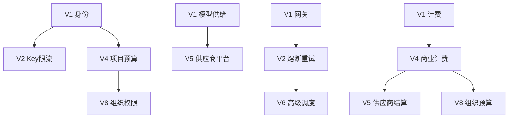

# 功能演进矩阵

本文档以"能力主线"为单位，说明同一项产品能力如何跨版本演进。

---

## 1. 文档职责

本文档回答以下问题：

- 一项能力最早在哪个版本出现
- 后续版本具体增加了什么用户可感知行为
- 新阶段依赖哪些既有功能和发布门禁
- 达到什么结果才算完成该阶段
- 当前内容是现行功能、未来规划、历史迁移还是独立增强

本文档不替代其他权威来源：

- 产品愿景和完整范围以[产品蓝图](产品蓝图.md)为准
- 版本顺序和边界以[版本路线图](版本路线图.md)为准
- V1 功能行为以[V1 功能规格](../03-功能规格/V1/README.md)为准
- 后续版本的功能行为以各版本的功能规格为准

---

## 2. 能力主线列表

| 能力主线 | V1 | V2 | V3 | V4 | V5 | V6 | V7 | V8 |
| --- | --- | --- | --- | --- | --- | --- | --- | --- |
| 身份与权限 | ✅ | ➕ | - | ➕ | - | - | - | ➕ |
| 模型供给 | ✅ | - | - | - | ➕ | - | - | - |
| 网关调用 | ✅ | ➕ | - | - | - | ➕ | - | - |
| 计费与账务 | ✅ | - | - | ➕ | ➕ | - | - | ➕ |
| 支付与退款 | ✅ | - | - | ➕ | - | - | - | - |
| 平台运营 | ✅ | ➕ | - | - | ➕ | - | ➕ | ➕ |

**图例**：
- ✅ 该版本首次引入
- ➕ 该版本增强
- - 该版本无变化
- 🔄 该版本重构

---

## 3. 能力主线详情

### 身份与权限

#### V1：个人账户与 API Key

**功能范围**：
- 用户注册、登录
- 个人 API Key 生命周期
- 基础鉴权

**关键功能**：
- V1-FR-001：用户注册
- V1-FR-002：用户登录
- V1-FR-005：API Key 生命周期

**完成标准**：用户可以注册、登录、创建和管理 API Key

**状态**：现行功能，[V1 功能规格](../03-功能规格/V1/01-身份与权限/)

---

#### V2：Key 级限流与安全增强

**功能范围**：
- API Key 级别的限流
- Key 过期自动禁用
- 安全审计增强

**依赖**：V1 API Key 基础功能稳定

**完成标准**：每个 Key 可以独立设置限流，超过限制自动阻断

**状态**：规划，[V2 稳定网关](后续版本/V2-稳定网关.md)

---

#### V4：项目与预算控制

**功能范围**：
- 项目（Project）概念
- 项目级预算
- 项目成员

**依赖**：V1 基础账户体系

**完成标准**：用户可以创建项目，为项目设置预算，项目内的 Key 共享预算

**状态**：规划，[V4 商业支付](后续版本/V4-商业支付.md)

---

#### V8：组织与企业权限

**功能范围**：
- 组织账户
- 成员权限管理
- 企业 SSO

**依赖**：V4 项目和预算稳定

**完成标准**：企业可以创建组织，管理成员，成员使用组织的余额和配额

**状态**：规划，[V8 企业化](后续版本/V8-企业化.md)

---

### 模型供给

#### V1：基础模型管理

**功能范围**：
- 服务商管理
- 上游账号管理
- 模型资产发现

**关键功能**：
- V1-FR-006：添加上游服务商
- V1-FR-008：上游账号管理
- V1-FR-013：模型列表与发现

**完成标准**：管理员可以添加服务商、配置账号、发现模型

**状态**：现行功能

---

#### V5：供应商自助平台

**功能范围**：
- 供应商注册与审核
- 供应商自助添加账号
- 供应商报价

**依赖**：V1 基础供给体系 + V4 计费体系

**完成标准**：供应商可以自助注册、管理账号、设置报价

**状态**：规划，[V5 供应商平台](后续版本/V5-供应商平台.md)

---

### 网关调用

#### V1：多协议入口

**功能范围**：
- OpenAI 兼容接口
- Anthropic Messages
- Gemini generateContent

**关键功能**：
- V1-FR-034：面向调用方的多协议入口

**完成标准**：用户可以使用三种协议调用模型

**状态**：现行功能

---

#### V2：失败重试与熔断

**功能范围**：
- 智能重试
- 熔断降级
- 超时控制

**依赖**：V1 网关基础功能

**完成标准**：失败请求自动重试，异常账号自动熔断

**状态**：规划

---

#### V6：高级调度

**功能范围**：
- 优先级队列
- 预留容量
- 动态路由

**依赖**：V2 稳定网关

**完成标准**：支持按优先级调度，VIP 用户有预留容量

**状态**：规划，[V6 高级调度](后续版本/V6-高级调度.md)

---

### 计费与账务

#### V1：基础计费

**功能范围**：
- 用量采集
- 余额冻结与扣费
- 消费记录

**关键功能**：
- V1-FR-018：调用用量采集
- V1-FR-019：余额冻结与调用扣费

**完成标准**：用户调用后自动扣费，有完整的消费记录

**状态**：现行功能

---

#### V4：商业计费

**功能范围**：
- 多币种支持
- 发票开具
- 账单下载

**依赖**：V1 基础计费稳定

**完成标准**：企业用户可以获得正规发票和详细账单

**状态**：规划

---

#### V5：供应商结算

**功能范围**：
- 供应商成本核算
- 供应商账单
- 自动结算

**依赖**：V4 商业计费 + V5 供应商平台

**完成标准**：自动核算供应商成本，生成供应商账单

**状态**：规划

---

#### V8：组织预算

**功能范围**：
- 组织级预算
- 成员配额
- 预算告警

**依赖**：V4 预算控制

**完成标准**：组织管理员可以为成员分配配额，超额告警

**状态**：规划

---

## 4. 跨版本依赖图

---

## 5. 维护规则

1. 按能力主线组织，不按功能编号
2. 清晰标注每个阶段的状态（现行/规划/历史）
3. 新阶段必须说明依赖的既有能力
4. 跨版本的同一能力保持概念一致性
5. 每个阶段有明确的完成标准

---

## 6. 使用场景

### 查看某个能力的完整演进

想了解"身份与权限"从 V1 到 V8 的演进 → 查看本文档的"身份与权限"章节

### 查看某个版本的所有新增能力

想了解 V4 新增了什么 → 查看本文档，找到所有标记为 V4 的章节

### 规划新功能时确定放在哪个版本

新功能"企业 SSO" → 查看"身份与权限"演进，发现应该放在 V8

---

**示例完整演进**：

### 用户余额管理的完整演进

| 版本 | 能力名称 | 增强内容 | 状态 |
| --- | --- | --- | --- |
| V1 | 基础余额账户 | 充值、扣费、余额查询 | ✅ 现行 |
| V4 | 多币种余额 | 支持美元、欧元 | 📋 规划 |
| V4 | 预算控制 | 项目级预算上限 | 📋 规划 |
| V5 | 信用额度 | 企业用户信用支付 | 📋 规划 |
| V8 | 组织余额 | 组织级余额池 | 📋 规划 |

**依赖关系**：V4 多币种 ← V1 基础；V5 信用 ← V4 预算；V8 组织 ← V4 预算
