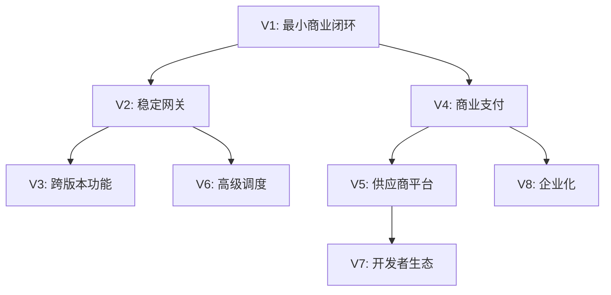

# 版本路线图

本文档定义产品的版本演进路线，说明每个版本的主题、目标、边界和依赖关系。

---

## 1. 版本命名规则

统一使用 `V1` 到 `V8` 作为产品版本编号。

不再使用 `V0.1`、`V0.2`、`V1.1`、`V1.2` 等并行编号，避免排期、需求追踪和验收口径混乱。

允许在单个正式版本内使用"发布门禁"和"交付阶段"管理风险，例如 `V1 发布门禁`、`V1-P1`、`V1-P2`。

---

## 2. 版本概览

| 版本 | 主题 | 核心目标 | 状态 | 预计时间 |
| --- | --- | --- | --- | --- |
| V1 | {主题，例如：最小商业闭环} | {核心目标，例如：完整的用户注册到付费调用} | {开发中/规划中/已完成} | {时间，例如：2026 Q4} |
| V2 | {主题} | {核心目标} | {状态} | {时间} |
| V3 | {主题} | {核心目标} | {状态} | {时间} |
| V4 | {主题} | {核心目标} | {状态} | {时间} |
| V5 | {主题} | {核心目标} | {状态} | {时间} |

---

## 3. 版本详情

### V1：{主题}

**核心目标**：{详细描述核心目标}

**做什么**：
- {做什么项 1}
- {做什么项 2}
- {做什么项 3}

**不做什么**：
- {不做什么项 1}
- {不做什么项 2}
- {不做什么项 3}

**上游依赖**：
- {依赖项，例如：基础技术栈选型}

**下游影响**：
- 为 V2 提供稳定的基础能力
- 为 V3 提供用户基础

**成功标准**：
- {标准 1，例如：用户可以完成注册到付费调用的完整链路}
- {标准 2，例如：核心接口可用性 > 99.5%}

**详细规格**：[V1 版本总览](当前版本/V1-版本总览.md)

**当前状态**：{开发中 / 已完成}

**预计完成**：{日期}

---

### V2：{主题}

**核心目标**：{详细描述核心目标}

**做什么**：
- {做什么项 1}
- {做什么项 2}

**不做什么**：
- {不做什么项 1}
- {不做什么项 2}

**上游依赖**：
- V1 基础功能完成并稳定
- {其他依赖}

**下游影响**：
- 为 V3 提供高可用保障

**成功标准**：
- {标准 1}
- {标准 2}

**详细规格**：[V2 详细规划](后续版本/V2-{主题}.md)（规划阶段，未细化到功能规格）

**当前状态**：规划中

**预计完成**：{日期}

---

### V3-V8：{概要说明}

后续版本当前处于概要规划阶段，详细功能规格将在前序版本接近完成时逐步细化。

---

## 4. 版本间依赖关系



**关键依赖说明**：
- V2 必须等 V1 稳定后才能开始（基础能力依赖）
- V4 可以与 V2 并行开发（独立功能域）
- V8 必须等 V4 完成（企业计费依赖商业支付）

---

## 5. 里程碑时间线

```
2026 Q4  ████████████████  V1 最小商业闭环
2027 Q1      ████████████  V2 稳定网关
2027 Q2          ████████  V4 商业支付
2027 Q3              ████  V5 供应商平台
2027 Q4                ██  V6 高级调度
```

---

## 6. 版本进入开发门禁

新版本从"规划骨架"升级为"可交给研发或 AI 实现"的条件，详见 [版本进入开发门禁](版本进入开发门禁.md)。

未通过门禁的版本只能做概要规划，不能细化到功能规格。

---

## 7. 跨版本能力演进

某些能力会跨越多个版本逐步演进，详见 [功能演进矩阵](功能演进矩阵.md)。

---

## 8. 维护规则

1. 新增版本必须先在此文档登记
2. 版本主题和目标一旦确定不轻易变更
3. 版本间依赖关系必须明确
4. 后续版本保持概要，不过早细化
5. 当前版本接近完成时，才细化下一版本

---

**示例**：

### V1：最小商业闭环

**核心目标**：让用户可以注册、充值、使用 API Key 调用模型，并按实际用量扣费。

**做什么**：
- 用户注册、登录、API Key 管理
- 服务商、上游账号、模型资产管理
- 多协议网关（OpenAI、Anthropic、Gemini）
- 用量采集、余额冻结与扣费
- 充值、微信支付、退款
- 管理后台、概览、审计

**不做什么**：
- OAuth 第三方登录
- 企业组织和成员
- 高级限流和熔断
- 供应商自助平台

**上游依赖**：
- PostgreSQL、Redis 基础设施
- 微信支付商户号

**下游影响**：
- 为 V2 提供稳定的基础能力
- 为 V4 提供基础计费能力

**成功标准**：
- 用户可以完成注册到付费调用的完整链路
- 核心接口可用性 > 99.5%
- 计费准确率 100%

**详细规格**：[V1 版本总览](当前版本/V1-版本总览.md)

**当前状态**：开发中（70% 完成）

**预计完成**：2026-10-31

---

### V2：稳定网关

**核心目标**：提升网关的稳定性、可靠性和可观测性。

**做什么**：
- 失败重试与指数退避
- 熔断降级
- 细粒度限流
- 分布式追踪
- 详细的可观测性

**不做什么**：
- 新协议支持
- 新计费模式
- 企业功能

**上游依赖**：
- V1 核心功能完成并稳定运行

**下游影响**：
- 为 V3 及后续版本提供高可用保障

**成功标准**：
- 网关可用性 > 99.95%
- 失败重试成功率 > 90%
- 全链路追踪覆盖率 100%

**详细规格**：[V2 稳定网关](后续版本/V2-稳定网关.md)

**当前状态**：规划中

**预计完成**：2027-03-31
